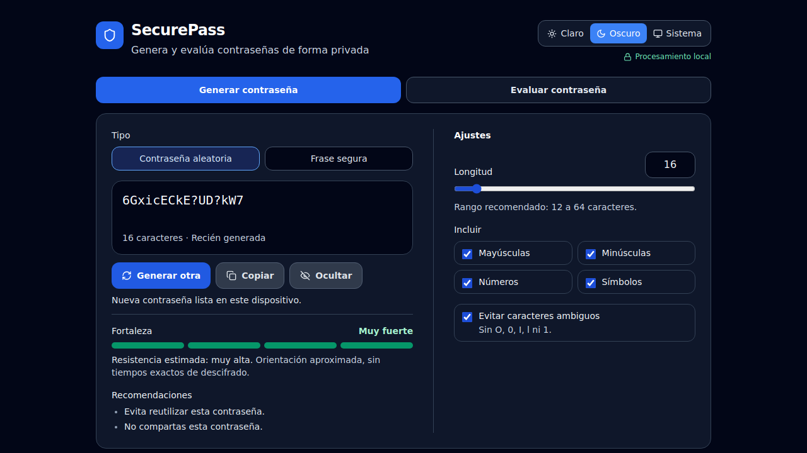
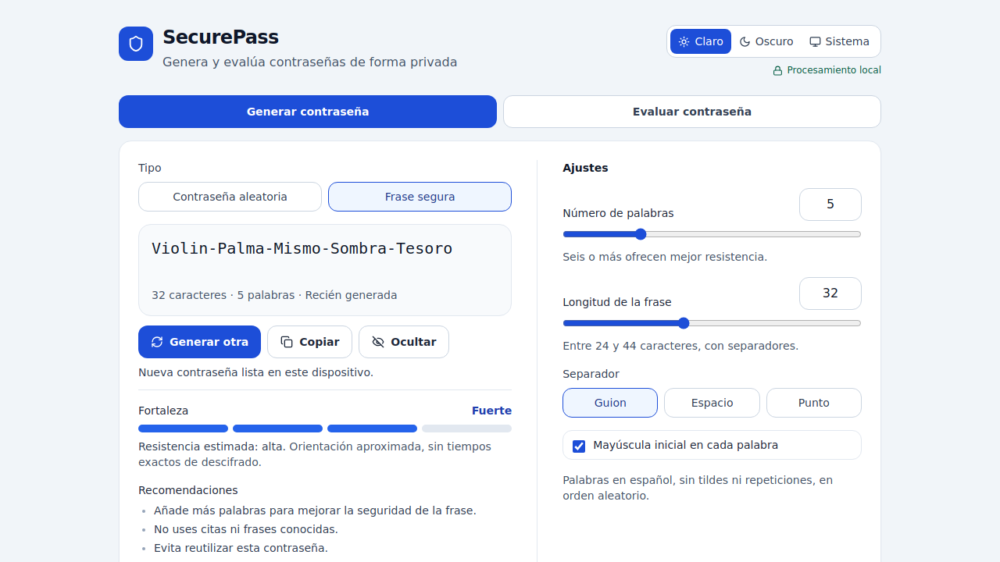
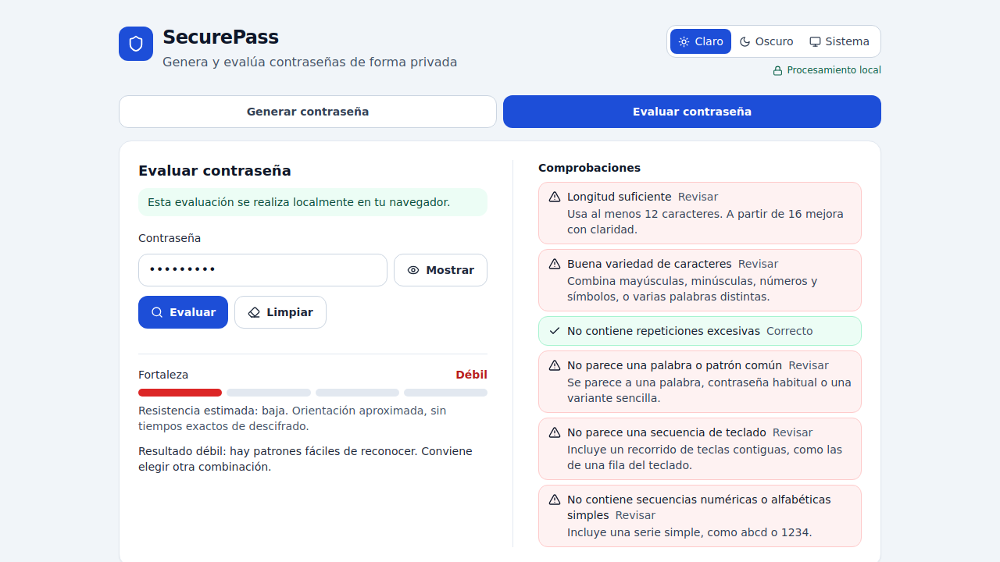
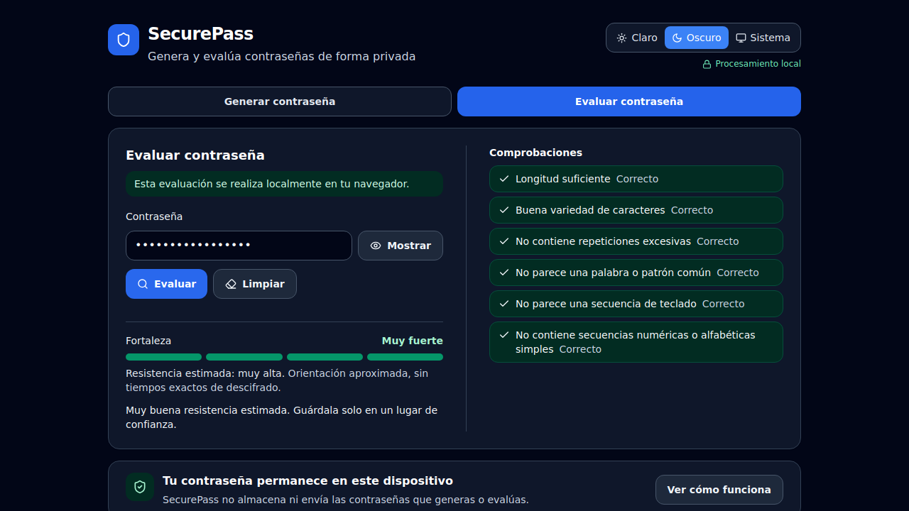
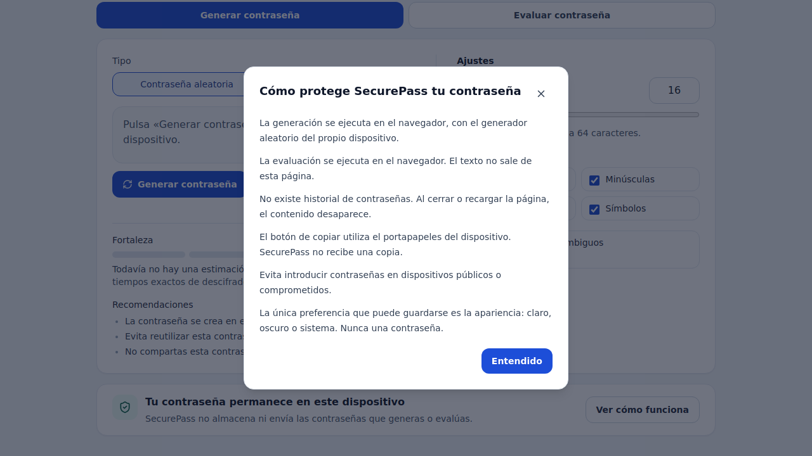
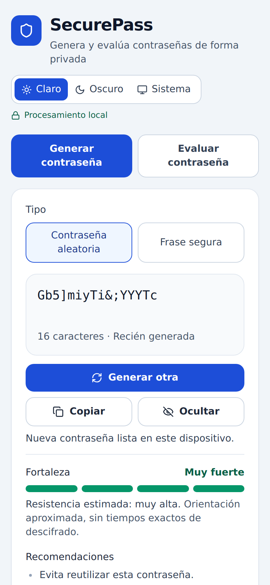

# SecurePass

Aplicación web para generar y evaluar contraseñas de forma privada. Todo se procesa en el navegador: no tiene cuentas, inicio de sesión ni base de datos, y las contraseñas nunca se envían a un servidor.



## Funciones

- **Contraseñas aleatorias** de 12 a 64 caracteres, con mayúsculas, minúsculas, números y símbolos, y opción para evitar caracteres ambiguos (O, 0, I, l, 1).
- **Frases seguras** con palabras en español: elige el número de palabras, la longitud y el separador.
- **Evaluador** que detecta palabras y contraseñas comunes, recorridos de teclado, repeticiones y series como `abcd` o `1234`.
- **Fortaleza aproximada** (débil, moderada, fuerte o muy fuerte), sin prometer tiempos de descifrado.
- Modo claro, oscuro y del sistema; diseño adaptable a móvil; navegación completa con teclado y lectores de pantalla.

| Frase segura | Evaluador |
|---|---|
|  |  |

| Evaluación fuerte (modo oscuro) | Explicación de privacidad |
|---|---|
|  |  |

<p align="center"></p>

## Privacidad

- La generación usa `crypto.getRandomValues`, el generador criptográfico del navegador.
- Generar y evaluar no hace peticiones de red.
- Las contraseñas no se guardan en `localStorage`, `sessionStorage`, cookies ni IndexedDB. La única preferencia guardada es la apariencia.
- Copiar usa el portapapeles del dispositivo.

## Instalación con Docker

```bash
git clone https://github.com/derazo1/securepass.git
cd securepass
docker compose up -d --build
```

Abre `http://localhost:8080`. HTTPS es opcional y se activa solo al añadir un certificado.

La guía completa está en **[docs/INSTALACION.md](docs/INSTALACION.md)**: instalar Docker, configurar puertos, activar HTTPS (certificado propio, mkcert o Let's Encrypt automático), publicar en la red y solucionar problemas.

## Desarrollo

Requisitos: Node.js 22 y npm.

```bash
npm install
npm run dev       # servidor de desarrollo en http://localhost:5173
npm test          # pruebas
npm run build     # archivos estáticos en dist/
npm run preview   # previsualiza la compilación
```

## Estructura

```text
src/
  components/   interfaz (React + Tailwind)
  services/     generación y evaluación, sin dependencias de la interfaz
  hooks/        tema claro/oscuro
nginx/          configuración de Nginx y script de arranque
scripts/        emisión opcional de certificados con Let's Encrypt
docs/           guía de instalación y capturas
```

## Licencia

[MIT](LICENSE)
