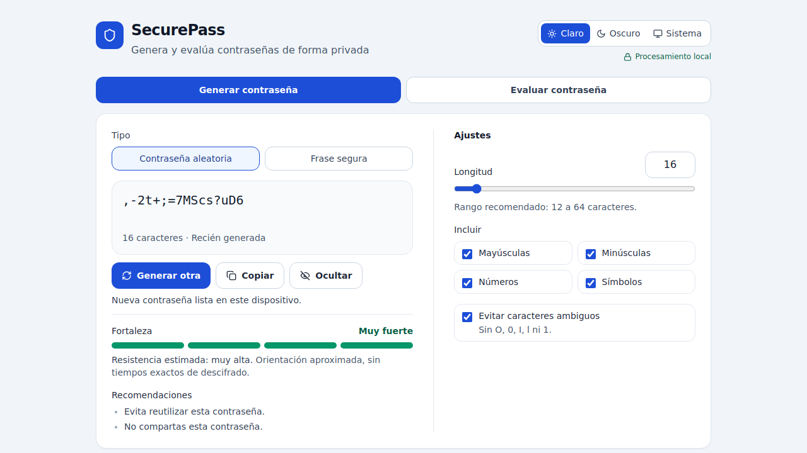

# Instalación y configuración

Esta guía explica cómo desplegar SecurePass con Docker en cualquier equipo o servidor. HTTPS es opcional: sin certificados la aplicación funciona por HTTP, y se activa sola cuando encuentra uno.

## Índice

1. [Requisitos](#1-requisitos)
2. [Instalar Docker](#2-instalar-docker)
3. [Descargar SecurePass](#3-descargar-securepass)
4. [Configurar](#4-configurar)
5. [Arrancar y comprobar](#5-arrancar-y-comprobar)
6. [Activar HTTPS](#6-activar-https)
7. [Publicar en la red](#7-publicar-en-la-red)
8. [Actualizar, detener y desinstalar](#8-actualizar-detener-y-desinstalar)
9. [Solución de problemas](#9-solución-de-problemas)

## 1. Requisitos

- Docker Engine 24 o superior con el plugin Compose v2 (`docker compose`).
- Unos 200 MB de disco para la imagen.
- Git, para clonar el repositorio (o descarga el ZIP desde GitHub).

No necesitas Node.js: la imagen compila la aplicación por dentro.

## 2. Instalar Docker

### Ubuntu y Debian

```bash
sudo apt-get update
sudo apt-get install -y ca-certificates curl git
sudo install -m 0755 -d /etc/apt/keyrings
. /etc/os-release
sudo curl -fsSL "https://download.docker.com/linux/$ID/gpg" -o /etc/apt/keyrings/docker.asc
echo "deb [arch=$(dpkg --print-architecture) signed-by=/etc/apt/keyrings/docker.asc] https://download.docker.com/linux/$ID $VERSION_CODENAME stable" \
  | sudo tee /etc/apt/sources.list.d/docker.list > /dev/null
sudo apt-get update
sudo apt-get install -y docker-ce docker-ce-cli containerd.io docker-buildx-plugin docker-compose-plugin
```

Para usar Docker sin `sudo`, añade tu usuario al grupo `docker` y vuelve a iniciar sesión:

```bash
sudo usermod -aG docker "$USER"
```

### Otros sistemas

- **Windows y macOS:** instala [Docker Desktop](https://docs.docker.com/desktop/).
- **Otras distribuciones Linux:** sigue la [guía oficial de Docker Engine](https://docs.docker.com/engine/install/).

Comprueba la instalación:

```bash
docker --version
docker compose version
```

## 3. Descargar SecurePass

```bash
git clone https://github.com/derazo1/securepass.git
cd securepass
```

## 4. Configurar

Todos los ajustes son opcionales. Para cambiar alguno, crea un archivo `.env` a partir del ejemplo:

```bash
cp .env.example .env
```

| Variable | Por defecto | Uso |
|---|---|---|
| `BIND_ADDRESS` | `127.0.0.1` | Interfaz donde se publica. `127.0.0.1` solo permite abrirla desde el propio equipo; `0.0.0.0` la abre a toda la red. |
| `HTTP_PORT` | `8080` | Puerto HTTP en el equipo anfitrión. |
| `HTTPS_PORT` | `8443` | Puerto HTTPS en el equipo anfitrión. |
| `SECUREPASS_TLS` | `auto` | `auto`: HTTPS si hay certificados. `on`: los exige y no arranca sin ellos. `off`: siempre HTTP. |

Las variables `DOMAIN`, `ACME_EMAIL` y `DNS_PROVIDER` solo se usan con Let's Encrypt (sección 6).

## 5. Arrancar y comprobar

```bash
docker compose up -d --build
```

Comprueba que está en marcha:

```bash
docker compose ps
docker compose logs securepass
```

El registro indica el modo en que arrancó:

```text
SecurePass: modo HTTP. Monta certificados en /etc/nginx/certs para activar HTTPS.
```

Abre `http://localhost:8080`.



## 6. Activar HTTPS

Con HTTPS activo:

- El puerto HTTP solo redirige a HTTPS.
- Se aceptan únicamente TLS 1.2 y 1.3, con cifrados modernos, HTTP/2 y HSTS.
- El botón «Copiar» funciona desde cualquier equipo de la red. Los navegadores solo permiten el portapapeles en `localhost` o por HTTPS.

Elige la opción que corresponda a tu entorno.

### Opción A: certificado propio

Sirve cualquier certificado: uno emitido por tu organización, uno comprado o uno de Let's Encrypt obtenido por otra vía.

1. Copia los archivos a la carpeta `certs/` con estos nombres:
   - `certs/fullchain.pem`: certificado más la cadena intermedia.
   - `certs/privkey.pem`: clave privada.
2. Protege la clave:

   ```bash
   chmod 600 certs/privkey.pem
   ```

3. Reinicia el contenedor:

   ```bash
   docker compose up -d --force-recreate securepass
   ```

El registro mostrará `SecurePass: HTTPS activado.` Abre `https://<tu-nombre>:8443`, o sin puerto si usas `HTTPS_PORT=443`.

### Opción B: certificado de pruebas con mkcert

Útil para probar en tu propio equipo. [mkcert](https://github.com/FiloSottile/mkcert) crea una autoridad local en la que confía tu navegador.

```bash
mkcert -install
mkdir -p certs
mkcert -cert-file certs/fullchain.pem -key-file certs/privkey.pem localhost 127.0.0.1
docker compose up -d --force-recreate securepass
```

Abre `https://localhost:8443`. Otros equipos no confiarán en este certificado.

### Opción C: Let's Encrypt automático

Un contenedor opcional con [acme.sh](https://github.com/acmesh-official/acme.sh) emite y renueva el certificado. Valida mediante DNS, así que el servidor no necesita estar accesible desde internet y también sirve en redes internas.

Requisitos:

- Un nombre dentro de un dominio público tuyo, por ejemplo `securepass.example.com`.
- Que ese nombre apunte al servidor en el DNS que usan tus equipos (interno o público).
- Acceso al DNS **público** del dominio: credenciales de API del proveedor o, en modo `manual`, poder crear un registro TXT.

Pasos:

1. Completa en `.env`:

   ```dotenv
   DOMAIN=securepass.example.com
   ACME_EMAIL=tu-correo@example.com
   DNS_PROVIDER=dns_cf
   CF_Token=...
   ```

   `DNS_PROVIDER` es el módulo de acme.sh para tu proveedor (`dns_cf` Cloudflare, `dns_aws` Route 53, `dns_gcloud`, `dns_azure`, `dns_gd`, etc.). Las variables de credenciales dependen del proveedor: consulta la [lista de proveedores](https://github.com/acmesh-official/acme.sh/wiki/dnsapi). Usa un token limitado a editar el DNS de esa zona.

2. Protege el archivo y emite el certificado:

   ```bash
   chmod 600 .env
   ./scripts/issue-cert.sh
   ```

3. Arranca o reinicia la aplicación:

   ```bash
   docker compose up -d --force-recreate securepass
   ```

El contenedor `acme` renueva el certificado antes de que caduque, y Nginx recarga la configuración cada 12 horas para usar el renovado.

Si tu proveedor no tiene API, usa `DNS_PROVIDER=manual`: el script muestra el registro TXT que debes crear y los comandos para completar la emisión.

### Opción D: detrás de un proxy inverso

Si ya tienes Traefik, Caddy, otro Nginx o un balanceador que gestiona TLS, deja `SECUREPASS_TLS=off` y apunta el proxy al puerto HTTP del contenedor. En ese caso, configura HSTS en el proxy.

## 7. Publicar en la red

Por defecto SecurePass solo escucha en `127.0.0.1`. Para que otros equipos puedan abrirla:

```dotenv
BIND_ADDRESS=0.0.0.0
HTTP_PORT=80
HTTPS_PORT=443
```

```bash
docker compose up -d --force-recreate securepass
```

Recomendaciones:

- Publícala con HTTPS.
- Si el servidor tiene varias interfaces, usa la IP de la interfaz interna en `BIND_ADDRESS` en vez de `0.0.0.0`.
- Docker publica puertos por delante de cortafuegos como `ufw`. Limita el acceso con `BIND_ADDRESS` o con reglas en la cadena `DOCKER-USER`.
- SecurePass está pensada para uso interno. No la expongas a internet sin una capa de acceso como VPN o un proxy autenticado.

## 8. Actualizar, detener y desinstalar

Actualizar a la última versión:

```bash
git pull
docker compose up -d --build
```

Detener:

```bash
docker compose down
```

Desinstalar, incluidos imagen, certificados y configuración:

```bash
docker compose --profile letsencrypt down --rmi local
rm -rf certs acme .env
```

## 9. Solución de problemas

| Síntoma | Causa probable | Solución |
|---|---|---|
| `SECUREPASS_TLS=on, pero faltan ...` | No hay certificados en `certs/`. | Revisa los nombres `fullchain.pem` y `privkey.pem`, o usa `SECUREPASS_TLS=auto`. |
| El registro dice «modo HTTP» aunque copiaste certificados | Nombres distintos o la clave no es legible. | Revisa nombres y permisos, y vuelve a crear el contenedor con `--force-recreate`. |
| `port is already allocated` | Otro servicio usa ese puerto. | Cambia `HTTP_PORT` o `HTTPS_PORT` en `.env`. |
| Otros equipos no pueden abrirla | `BIND_ADDRESS` es `127.0.0.1` o un cortafuegos bloquea el puerto. | Usa `0.0.0.0` o la IP interna y revisa el cortafuegos. |
| «No se pudo acceder al portapapeles» | Se abrió por HTTP desde otro equipo. | Activa HTTPS. |
| El navegador avisa de que el certificado no es de confianza | Certificado autofirmado, de mkcert en otro equipo o sin la cadena intermedia. | Usa un certificado de una autoridad reconocida e incluye la cadena completa en `fullchain.pem`. |
| Let's Encrypt falla al validar | Credenciales DNS incorrectas o el TXT aún no se propagó. | Revisa `docker compose --profile letsencrypt logs acme` y vuelve a ejecutar el script. |
